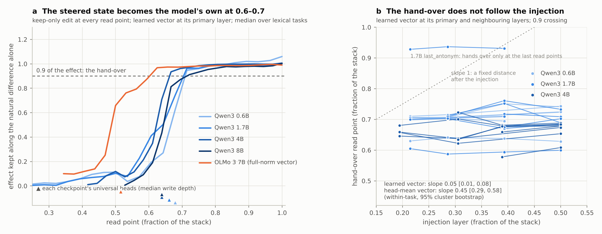
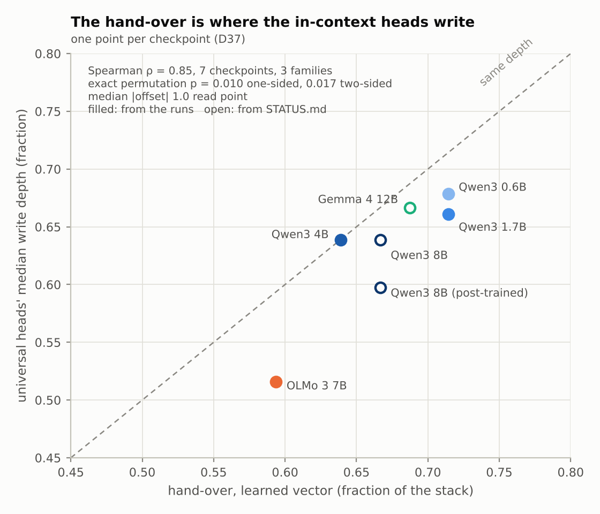
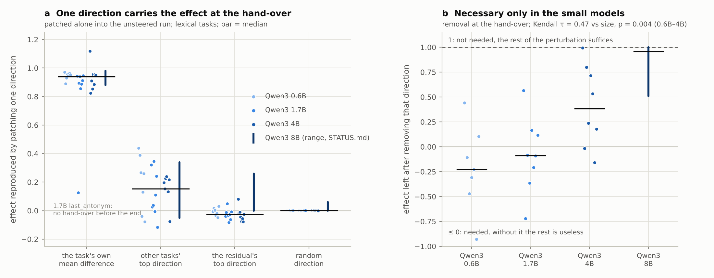
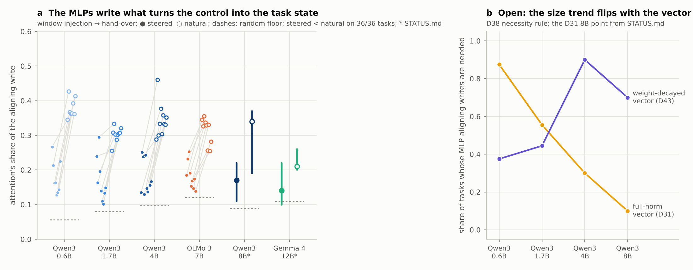

# The single-control line: close-out

Written 2026-10-12. Closes the line of `fable` decisions D1–D44 (2026-09-07 to 2026-10-03): one low-dimensional
control injected at the final query token and followed through depth. The line is closed: no further runs are
planned for it. Its tools carry over to the next stage (the subroutine census; see the end). Numbers come from the
run directories on the RunPod volumes, re-read for this note by `scripts/single_control_summary.py`. Where a run
directory no longer exists, the number comes from `STATUS.md` and is marked as such. Tables and figures are in
`docs/single_control/`.

## In one paragraph

A task control (a function vector, or a vector fitted to the task) is injected at 0.2–0.5 of the stack into a
zero-shot prompt. It is not transported: within a few blocks the injected direction is gone. It is *converted*:
the blocks after it rotate the perturbation, through near-orthogonal writes, into the model's own few-shot state
for that task. The conversion completes at a fixed depth, about 0.6–0.7 of the stack. For the fitted vector that depth
barely moves with the injection layer (the head-mean vector's moves partly), and it is the depth at which the model's in-context heads write. At that depth one
direction carries the effect, and it is the task's own mean few-shot-minus-zero-shot difference. That direction
is sufficient on every model, but necessary only on the small ones. The writes that perform the conversion come
from the MLPs, not the heads. The reading: in the natural run the heads deliver the demonstrations' signal and
the MLPs transform it; the injected vector replaces the delivery and is finished by the same MLPs, at the same
depth. Seven checkpoints from three families (Qwen3 0.6B–8B, Qwen3-8B post-trained, OLMo 3 7B, Gemma 4 12B)
support this. Two seeds were run on Qwen3 and one on the others.

```
  natural run (8 demonstrations)                 steered run (zero-shot + injected vector v)

  demos ──heads (delivery)──┐                     v added at 0.2–0.5 of the stack ──┐
                            ▼                                                       ▼
          query token: MLPs of the blocks up to the hand-over ◄── the same MLPs, the same blocks
                            │                                                       │
                            └──────────► the task's own direction (rank one) ◄──────┘
                                         hand-over at ~0.6–0.7 = the heads' write depth
```

## Setup, briefly

| | |
|---|---|
| **Models** | Qwen3 0.6B / 1.7B / 4B / 8B Base and Qwen3-8B post-trained; OLMo 3 7B; Gemma 4 12B. Run in bf16, with statistics computed in float64. |
| **Tasks** | In-context tasks, mostly with single-token answers: antonym, plural, singular, past tense, present participle, uppercase, number to words, the k-th word of a list, add-k. Composites: last-antonym, arithmetic-words, and five compositions (D41). |
| **Controls** | (i) The head-mean function vector (Todd et al.): the mean output of a universal top-head set, mapped through W_o (D21, D26). (ii) A single vector fitted by gradient descent to the target log-probability, either at the residual norm (D31) or with a free norm under weight decay (D43). Injected at the final query token. |
| **Nulls** | Matched random directions of several kinds: isotropic, orthogonal, covariance-matched, other-task, demonstration-variation, permuted-target fits, norm-matched edits. Tests use a paired hierarchical bootstrap (D15, D18, D31, D35). |
| **Hand-over** | The first read point m at which keeping *only* the perturbation's component along the prompt's own natural difference h_m(few-shot) − h_m(zero-shot) retains ≥ 0.9 of the effect (D33, D37). |
| **Scope** | Every capture and edit is at the final query token. Targets are mostly single tokens. |

## What is established

### 1. The geometry of a steered perturbation is generic (a method result)

Gain, dimensional expansion and new-subspace creation, the quantities the pilot was designed around
(`docs/PROJECT.md`), are reproduced by any in-distribution direction of the same norm. Against covariance-matched
and other-task nulls their z-scores are about 0 (D15–D17). Any push also produces a shared downstream response:
- It is coherent across random directions (coherence 0.5–0.85 by the last read point).
- It sits in the massive-activation coordinates and is anti-aligned with the mean residual.
- Its logit lens promotes punctuation and function words.

`docs/GENERIC_RESPONSE.md` condenses that line. Every alignment quoted below has this response removed. The
lesson that carries forward: **geometric summaries of a perturbation say nothing about its content without causal
readouts and matched nulls.**

### 2. Conversion, not transport

By the last read point the learned vector's perturbation is orthogonal to the injected direction (cosine
0.00–0.06). Along the way it turns 20–25° per block. Consecutive increments are near-orthogonal (cosine
0.01–0.06), and each is partly the write the same block makes when demonstrations are present (cosine 0.39–0.60).
Its projection on the natural difference *at that depth* grows from about 0.05 to 0.6–0.8 (D38, exploratory
rotation analysis). The injected direction itself is needed only for the first blocks (D29, D43).

### 3. The hand-over is at a fixed depth



*Figure 1a: the Qwen3 curves are the weight-decayed vector (D43/D44, the only 8B landmark run still on a volume);
OLMo 3's is the full-norm vector; the full-norm Qwen3 vector hands over within 0–2 read points of them (D44). Figure 1b: the
full-norm vector, iteration 10, seed 20260916.*

- **Where.** The learned vector hands over at 0.59–0.71 of the stack on all seven checkpoints:
  - Qwen3 0.6B and 1.7B: read point 20 of 28.
  - Qwen3 4B: 23 of 36.
  - Qwen3 8B: 24 of 36 (the post-trained 8B also 24).
  - OLMo 3 7B: 19 of 32.
  - Gemma 4 12B: 33 of 48.

  Within a model the spread over tasks is small: interquartile range 0–0.25 read points on Qwen3 0.6B–4B and
  2.5 on OLMo 3. The weight-decayed vector, at a fifth of the norm, hands over at the same read point (+0 to +2;
  D44).
- **Independent of the injection layer.** Iteration 10 covers 23 task × model groups: the learned vector at
  its primary layer and the neighbouring candidates, with injections spanning a median of 6 and up to 11 read
  points.
  - The within-task slope of hand-over on injection layer is **0.05 (95% cluster bootstrap 0.01–0.08)**. Moving
    the injection by six blocks moves the hand-over by a third of a read point. A fixed distance after the
    injection would give a slope of 1.
  - The *onset* of the rise moves a little more: the slope of the 0.5 crossing is 0.13 [0.09, 0.16].
  - The completion point is the invariant.
- **The head-mean vector is only partly invariant.** This is new in this close-out; see *Unresolved* §1. At its
  own selected layer it hands over where the learned vector does (median difference −1 read point, 75% of 28
  tasks within 2; D37). Moved across injection layers, its hand-over follows the injection with slope **0.45
  [0.29, 0.58]**, and 0.32 [0.19, 0.42] when only injections that recover at least 0.3 of the few-shot gap
  are kept. `docs/POSITIONING.md` §2 says the read point is fixed "for every … vector type". That holds tightly
  for the fitted vector and only partially for the model's own construction.

### 4. The hand-over is where the in-context heads write



Of the landmarks tested in D37, one sits at the hand-over: the median write depth of the universal heads, the
heads whose mean output *is* the head-mean vector. The others are the pool's rank-one onset, the lens's verbal
window and the Jacobian-lens workspace band.
- The heads write 0–2.5 read points below the hand-over on every checkpoint (median |offset| 1.0).
- Across the seven checkpoints the two depths co-vary: **Spearman ρ = 0.85**, with an exact permutation
  p = 0.010 one-sided and 0.017 two-sided.
- With seven points and a narrow range (0.59–0.71), the co-variation is suggestive. The offset is the stronger
  evidence.

### 5. One direction, the task's own, carries the effect at the hand-over



At the hand-over read point, patch the pool's mean natural difference alone into the *unsteered* run. It
reproduces a median **0.94** of the steered effect (lexical tasks, Qwen3 0.6B–4B, n = 23), which is 0.94 of the
per-prompt ceiling. The rate is 22 of 23 at ≥ 0.8; the exception is 1.7B last_antonym, which hands over only at
the last read points. The 8B gives 0.88–0.98 (STATUS). For comparison, at rank 1:
- the other tasks' top direction gives 0.15 (at most 0.44), although it holds most of the mean difference's
  norm;
- the residual's top direction gives −0.03;
- a random direction gives 0.00.

Ranks 2–8 add little: the median patch goes from 0.94 at rank 1 to 0.97 at rank 8 (D34). The geometric "dimensional expansion" of §1 is therefore not causal at this
depth: the causal dimensionality there is one, and it rises only after the hand-over.

### 6. Sufficient everywhere, necessary only in the small models

Remove that one direction from the steered perturbation at the hand-over. What is left of the effect:

| model | effect left (median) | source |
|---|---|---|
| Qwen3 0.6B | −0.23 | runs |
| Qwen3 1.7B | −0.09 | runs |
| Qwen3 4B | 0.39 | runs |
| Qwen3 8B | 0.96 | STATUS |

The trend with size is significant: Kendall τ = 0.47, p = 0.004 over the 23 tasks of 0.6B–4B. Random removals
leave 1.00. On the small models the direction is the unique carrier. On the 8B the effect is redundantly encoded
at the read point where it becomes sufficient, and the complement loses its power only 4–8 read points later
(D34). OLMo 3 sits in between: necessity arrives a few blocks later on four of seven tasks (D35). On Gemma 4 it
cannot be measured, because its deep half is hypersensitive to any residual edit.

### 7. The MLPs convert; the heads deliver



Split every block's increment at the query token into its attention and MLP writes, over the window from the
injection to the hand-over.
- **Attention's share of the aligning write** (the component along the natural difference) is a median 0.16 in
  the steered run against 0.33 in the natural run. It is lower in the steered run on **36 of 36** task–model
  pairs (sign test p ≈ 3·10⁻¹¹) for the full-norm vector, and on 37 of 37 for the weight-decayed one.
- **Removing attention's aligning components** never meets the necessity rule for the full-norm vector. For the
  weight-decayed vector it does so once (1.7B last_antonym).
- **The MLPs' aligning components** are necessary on many tasks; the counts are in Figure 4b and *Unresolved* §2.
- **What the steered run lacks** relative to the demonstrations is mostly the heads' contribution. It reproduces
  0.62–0.79 of the natural MLP aligning write but only 0.25–0.39 of the natural attention aligning write (D38).

The steered run therefore reaches the model's state through a different source at the delivery step (the vector
instead of the heads) and the same source at the transformation step (the MLPs in both).

### 8. Fitted controls and the model's own controls are different objects that do the same job

- **Orthogonal.** The fitted vector and the head mean are near-orthogonal (|cos| ≤ 0.13; ≤ 0.04 for the
  weight-decayed fit on three models) yet steer equally well (D31, D43). Fits from different starts agree only
  partly: cosine 0.01–0.33 at full norm, 0.39–0.68 with weight decay.
- **Switch versus dial.** Interpolating two labels' fitted vectors *switches* between them with nothing in
  between. This holds on every Qwen3 size, for positions in a list and for operands, and survives the
  within-label control of D44, on narrow evidence: 17 paths whose two fits genuinely differ, most of them on the
  two smaller models (the D44 amendment of 2026-10-10). Interpolating two positions' head means gives the position in between, where the
  head means are strong controls (D39, D40).
- **Reading.** The model's own control signal behaves like a parameter of the downstream computation. A control
  fitted from outside is admitted into the same computation as a choice.
- **Add-k.** The head mean carries add-1 but no operand k ≥ 2, whereas a single fitted vector carries add-3
  (D30, D31).

### 9. Compositions: one hand-off for the control, stages in the model

- **Injected controls.** For uppercase∘antonym and four other compositions, a composed control converts into the
  composition's state with one hand-off. Its perturbation is never closer to the first step's state, by more
  than 0.014 in cosine (D41). The components' head means, summed or injected one after the other at any depth,
  give 0.74–1.06 of the composed control: composition is a superposition of selectors.
- **The model's own computation.** Under layer-wise context masking it is staged: at the mid-stack masking peak
  the intermediate is the top-1 token in 5–98% of prompts, against about 0 at both ends (D42).
- **The tension.** Whether the control "skips a step the model takes" depends on the instrument; see
  *Unresolved* §3.

## What remains unresolved

Only the questions whose answer would change a conclusion are listed. Smaller loose ends are in the last bullet.

1. **Is the fixed read point a property of the model, or of the fitted control?** It is tight for the fitted
   vector (slope 0.05) and loose for the head mean (slope 0.3–0.45). Two readings fit:
   - The head mean is a weaker push away from its own layer: it recovers a median 0.35 of the few-shot gap there
     (0.09–0.92), against 0.70 at its own layer and 0.99 for the fitted vector, and its keep curve plateaus near
     the 0.9 threshold.
   - Alternatively, the model's own construction really is finished at a distance after it enters.

   The first predicts that the head mean's slope falls to the fitted vector's when its strength is matched per
   layer. That costs one `trajectories` pass per model with per-layer calibrated strengths.
2. **What carries the effect on the 8B when the rank-one direction is removed, and who needs the MLPs?**
   Removing the rank-one direction costs the 8B nothing (0.96 left). In addition, the size trend of MLP
   necessity *reverses* with the construction, as Figure 4b shows:
   - full-norm vector: 7/8, 5/9, 3/10, 1/10 (0.6B → 8B);
   - weight-decayed vector: 3/8, 4/9, 9/10, 7/10.

   D44 attributes part of the full-norm trend to that vector's slack. Neither result says what the redundant
   route on the 8B is.

   Makelov et al.'s subspace-patching illusion is the relevant caution: a direction that is sufficient but not
   necessary can act through a dormant pathway. Patching the model's own few-shot direction, rather than a
   fitted subspace, makes that less likely but does not exclude it. The obvious test is the same sufficiency and
   necessity readout at every read point between the hand-over and the end, on the 8B: rank-k removal at each
   read point. It locates where the redundancy collapses.
3. **One hand-off for the control, stages for the model.** Two results disagree:
   - The composed controls show no intermediate state (D41), and their component-specific share is at noise
     (D42, median e⊥ 0.0055).
   - The model's own few-shot computation of the same compositions shows the intermediate under masking (D42).

   However, masking has no steered counterpart, and the lens reads the natural run as staged on only 3 of 20
   rows. So "the control skips a step the model takes" is not established. Only "the control's direction holds
   no component-specific share" is. This is the question the next stage inherits: it needs readouts that can see
   an intermediate wherever it lives, which in practice means other token positions.
4. **Attention or MLPs?** Yang et al. (ICLR 2026) find that learned task vectors act mainly through attention OV
   circuits. Cheng et al. (2026) find the same for refusal steering. Our necessity tests on the *aligning
   increments* say the MLPs.
   - The two measure different things: our test asks which writes turn the state into the natural one; theirs
     asks which components mediate the output effect.
   - Both can hold: attention could carry an effect that does not pass through the natural direction.
   - Settling it means running their attention-OV reconstruction on our vectors, or our sublayer-necessity test
     on theirs.
5. **Smaller loose ends**, recorded and not pursued:
   - Necessity on Gemma 4 is unmeasurable without edits in the block's read frame.
   - The k-th word family's middle position never hands over.
   - Add-k and other multi-token targets are invisible to query-token edits.
   - OLMo 3, Gemma 4, add-k and D39–D44 have one seed each.
   - The learned selected layer is not reproducible across seeds (30 of 37 tasks), because the candidate layers
     are equivalent. Report per layer.

## Relation to prior work

| finding | closest prior work | verdict |
|---|---|---|
| §1 generic geometry | ActAdd (Turner et al. 2023): a norm-matched random vector shifts the next-token distribution more than a steering vector. Heimersheim & Mendel 2024; Lee & Heimersheim 2024: random-baseline choice. Massive activations (Sun et al. 2024). | Components anticipated; the full layerwise-geometry null and the shared response in the massive coordinates are new. |
| §3 fixed depth | Sia et al. (NeurIPS 2024): past a task-recognition layer, masking the context has no effect. Todd et al. 2024 and Hendel et al. 2023: task vectors work up to about mid-depth. | A critical depth for natural ICL is anticipated. Invariance to the injection layer, for an injected control, is new. |
| §4 heads' write depth | Yin & Steinhardt (ICML 2025): FV heads sit deeper than induction heads. | The co-location with the hand-over is new. |
| §5 rank one | Arditi et al. 2024 (refusal is one direction); Dong et al. 2025 (one task vector acts as one combined demonstration). | A rank-one, task-specific *causal* carrier at a fixed depth is new. Makelov et al. 2024 is the caveat (Unresolved §2). |
| §7 MLPs convert | Merullo et al. (NAACL 2024): the function is applied by FFNs at about two-thirds depth. Stolfo et al. 2023; Geva et al. 2022. | The direction is consistent. In tension with Yang et al. (ICLR 2026) and Cheng et al. 2026 (Unresolved §4). |
| §8 non-uniqueness, switch | Mack & Turner 2024 (MELBO); Jacob G-W & Turner 2024 (more than 800 orthogonal "write code" vectors); Bigelow et al. 2026 (sharp transitions). | Non-uniqueness is anticipated. FV-vs-fitted orthogonality and the dial-vs-switch split are new. |
| §9 compositions | Todd et al. 2024 (FV algebra); Internal CoT (Yang et al., EMNLP 2025), which uses the same antonym→uppercase design. | The superposition result confirms and extends Todd. The staged natural computation replicates Internal CoT. The single injected hand-off is new. |
| §2 conversion | Shih et al. 2026: a working steering vector need not reproduce the natural activation *at the injection site*. | Consistent: the convergence we report happens downstream, not at the site. |

Full citations are in `docs/LITERATURE.md` on `fable`, plus:
- Sia et al. 2024, arXiv 2403.04510
- Yin & Steinhardt 2025, arXiv 2502.14010
- Yang, Cho, Ding & Inoue 2026, arXiv 2509.24169
- Shih, Winnicki & Darve 2026, arXiv 2606.29522
- Makelov et al. 2024, arXiv 2311.17030
- Merullo et al. 2024, arXiv 2305.16130
- Arditi et al. 2024, arXiv 2406.11717

## What carries over

- **Prefer natural variation to injected pushes.** Patches of the model's own states (natural differences,
  interchange between real inputs) gave every positive causal result. Added vectors gave the generic response.
- **The hand-over as a marker.** The point where a control is used up and becomes the model's own computation is
  measurable to the read point, and it coincides with a component landmark (the heads' write depth). The next
  stage can use it as a "dispatch" marker.
- **Rank-k keep, remove and patch (D34), with matched random subspaces.** This is the causal dimensionality
  instrument: it reports what a geometric d_eff cannot.
- **Context masking (D42).** It is the only instrument that saw stages. It is also the only one that reaches
  beyond the query token.
- **The limit.** Everything here sits in one token column. The open questions above (§1–3) all point to readouts
  at other positions.

## Reproduce

```bash
# download the run directories listed in RUNS in scripts/single_control_summary.py (only the .json files are read)
uv run --with boto3 python scripts/runpod_log.py <run id> --download <dir>/run-<run id>    # on fable; per run, per data center
uv run --no-project --with numpy --with matplotlib python scripts/single_control_summary.py --runs-dir <dir> --out docs/single_control
```

The script writes the following to `docs/single_control/`:
- `stats.json`, which holds every statistic quoted above, the run directories it read and the STATUS-only values;
- five CSVs in `data/`;
- the four figures.

Bootstraps use 10 000 resamples with the fixed seed 20261012. The Spearman p is exact (all 5040 permutations).

Two caveats on the data:
- The 8B, post-trained 8B and Gemma 4 run directories of D34, D37 and D38 were deleted from the US-CA-2 volume
  to free space (`docs/INFRA.md`, item 6). Their values enter as STATUS medians or ranges, never as per-task
  points.
- The 8B curve in Figure 1a is the weight-decayed vector's (D44), the one 8B landmark run still on a volume.
